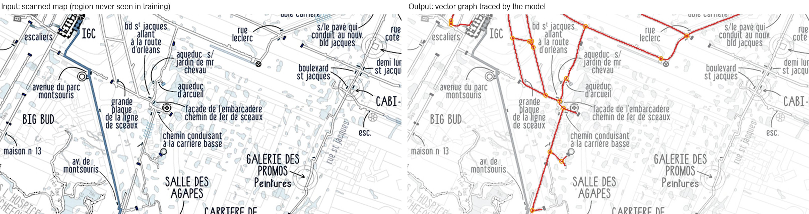

# MapTracer

**Turn a scanned map into a vector graph — and build the model that does it from your own clicks.**

MapTracer is a complete pipeline for map vectorization: an annotation app, a dataset generator, a trainable tracing
model, a tracing engine and the human-in-the-loop tools that make the next model better. You annotate a few networks by
hand, train, let the model trace the rest, correct only where it fails, and retrain in minutes. The output is a clean
graph (nodes, edges, intersections, dead ends), exportable to GeoJSON when the map is georeferenced.

The approach is the one used to extract road networks from aerial imagery (RoadTracer-style iterative graph
construction), applied to hand-drawn and scanned maps, where lines are thin, labels overlap the network and every map
has its own drawing style.



*Model `v6-ft` tracing a validation region it never saw during training: 97.6 % coverage, 84.8 % precision, 13 of 15
intersections found (3 px tolerance). Red = traced edges, orange = intersections the model placed.*

## How it works

**1. Annotate.** In the browser app you follow a network point by point; every click is stored as an event in a
replayable JSON log (unlimited undo, exact decision order kept).

**2. Generate training states.** `tools/oracle.py` turns an annotated graph into tens of thousands of supervised states:

- input: a 128 px window of the map centred on the current position, **rotated so the heading points up**, plus a
  4th channel with the network already traced (so the model learns not to go back);
- target: **32 angular sectors, multi-label** — one active sector = keep going, several = intersection, none = dead end;
- the tracer always moves by a **fixed 2 px step**, so there is no width or distance to regress;
- lateral offsets and heading noise teach re-centring; validation uses **spatial holdouts**, never random splits.

**3. Train.** `tools/model.py` is an ImageNet-pretrained **ResNet-18** with a 4-channel first convolution and 32 sigmoid
outputs, fully fine-tuned (AdamW + OneCycle, BCE on soft angular labels). A fine-tuning round on 88k states takes
**about 5 minutes** on an RTX 3080.

**4. Trace.** `tools/trace.py` runs the model in a closed loop: step forward along the sector closest to the heading,
open a branch when a lateral sector is confirmed, snap onto already-traced edges (junctions), stop when nothing is
active. It writes the graph, a GeoJSON and a report (coverage, precision, intersections matched, why each branch ended).

**5. Close the loop.** The app has the tools that turn the model's mistakes into data:

| mode | what it does |
|---|---|
| **Assisted** | the model proposes the next point, branch or dead end with its confidence; `Enter` accepts, a click corrects |
| **Auto** | the model traces the whole map; you fix only the regions where it is wrong — each fix becomes a small dataset of hard examples, with full provenance (model, commit, budget) |
| **Annotation audit** | a trained model replays every human annotation and flags disagreements: forgotten branches, dead ends marked too early |
| **Magic wand** (proof of concept) | flood-fill from a point with automatic tolerance and **leak plugging**: detects 1–3 px gaps in a line through which the fill would flood the background |
| **Wand at every step** | in Auto mode, each point placed by the model is re-centred in the gallery (largest inscribed disc on the step arc — a "balloon" between the walls), its width is measured, and gallery arms seen in the selection propose junctions alongside the model's |

## Results

Closed-loop tracing on two validation regions never seen in training (3 px tolerance):

| model | region 1 coverage | precision | intersections | region 2 coverage | intersections |
|---|---|---|---|---|---|
| oracle (upper bound of the tracing loop) | 99.8 % | 100 % | 15/15 | 99.6 % | 20/20 |
| v3 — 1 annotated network | 96.7 % | 87.7 % | 11/15 | 96.2 % | 12/20 |
| v4 — 2 annotated networks | 96.8 % | 94.2 % | 13/15 | 97.1 % | 15/20 |
| **v6-ft** — + 14 corrected regions | 97.2 % | 81.8 % | **14/15** | **98.6 %** | **17/20** |

Region 2 is annotated as a single route, not exhaustively, so its precision (≈ 60 % for every model) is capped by the
annotation, not by the model. Training data: 2,977 hand-placed points + 14 corrected regions → 88,304 states.

What the experiments taught (details in [`models/COMPARAISON.md`](models/COMPARAISON.md)):

- **Data beats hyperparameters.** Adding a second annotated network raised first-pass coverage on region 2 from 69 % to
  97 %. Window size (96 / 128 / 192 px), 32 vs 64 sectors and colour filtering all stayed within ±0.3 pt on isolated states.
- **Closed-loop tracing is noisy.** Two identical trainings with different seeds: indistinguishable on isolated states,
  but 94 % vs 63 % precision once the model drives itself. Variants are only compared on what is stable across seeds.
- **Fine-tune, don't retrain.** Retraining from scratch with many dense corrected regions dropped precision on region 1
  to 57–68 %; a 10-epoch fine-tune kept 82 % while still learning the corrections (one hard region: 49 % → 90 %
  coverage).

## Quick start

```bash
python3 -m venv .venv && .venv/bin/pip install -r requirements.txt
.venv/bin/python server.py                    # http://127.0.0.1:8080/app/ — manual, assisted, Auto, audit, wand
```

Runs on NVIDIA (CUDA), Apple Silicon (MPS) or CPU, selected automatically. On a MacBook M5: auditing 4,211 states takes
4 s, one training epoch on 2,400 examples 5.3 s, Auto mode traces at 167 steps/s. Manual annotation needs no
dependency at all (plain HTML/JS). A sample georeferenced map (6,307 px), its annotations, the corrected regions and the
trained models are in the repo; any image can be dropped into the app.

Train and trace from the command line:

```bash
# annotated graphs + corrected regions → training states, with spatial holdouts
python3 tools/oracle.py data/projects/*.maptracer.json data/zones/*.mapzones.json maps/<map>.jpg -o dataset/ \
        --window 128 --step 2 --lookahead 6 --near 6 --sectors 32 --holdout x0,y0,x1,y1
python3 tools/train.py dataset/ -o runs/new --epochs 10 --lr 1e-4 --init models/v6-ft/model.pt   # fine-tune, ~5 min
python3 tools/trace.py data/projects/<project>.maptracer.json maps/<map>.jpg -o out/ \
        --model runs/new/model.pt --bbox x0,y0,x1,y1 --seed auto                                  # trace + score a region
```

## Repository

```
app/          annotation app (manual, assisted, Auto, audit, magic wand) — plain JS
server.py     serves the app and the model API (/api/predict, /api/trace, /api/audit, /api/wand)
tools/        oracle.py (states), model.py, train.py, trace.py (tracing loop), audit.py, magic_wand.py, wand_refine.py,
              export_dataset.py, zones_report.py, make_synth.py (synthetic test map)
models/       11 trained models, each with weights (float16) and a NOTES.md: recipe, results, limits
data/         versioned training data: annotated projects and corrected regions
docs/         GUIDE.md — full documentation of every mode, tool and file format (in French)
```

## Limits

Trained so far on one map style; a new style needs a few annotated networks before the model is useful. The model
proposes and a human validates — it is not an autonomous tracer yet. Precision is measured against annotations that are
themselves incomplete.
